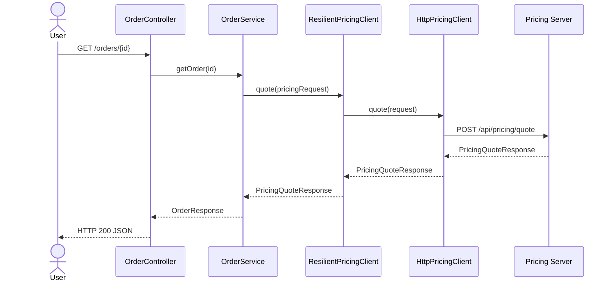
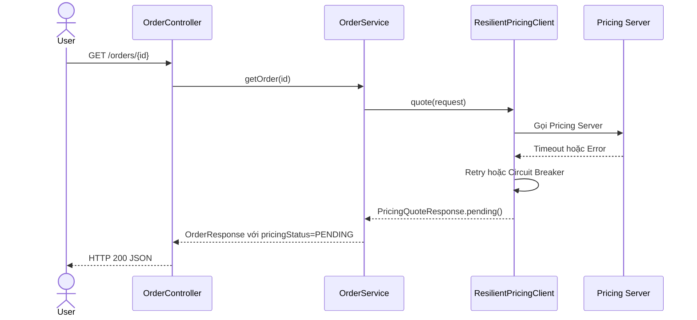
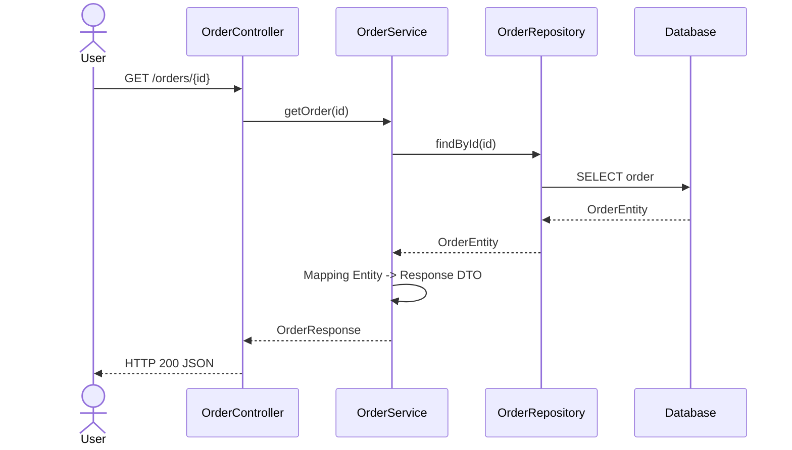

# Controller flow

## 1. Controller gọi tới server khác

`Controller` nên gọi `Service`, sau đó `Service` gọi client để giao tiếp với server bên ngoài.



### Khi Pricing Server bị lỗi



## 2. Controller không gọi tới server khác

Controller chỉ gọi service nội bộ. Service lấy dữ liệu từ repository hoặc database trong cùng ứng dụng.



## Vai trò của từng thành phần

```text
Controller = nhận request và trả response
Service    = xử lý business flow
Client     = gọi server khác
Repository = truy cập database
DTO        = dữ liệu request/response
```

Controller không nên tự gọi `RestClient` trực tiếp. Flow nên là:

```text
Controller -> Service -> PricingClient -> Server bên ngoài
```
